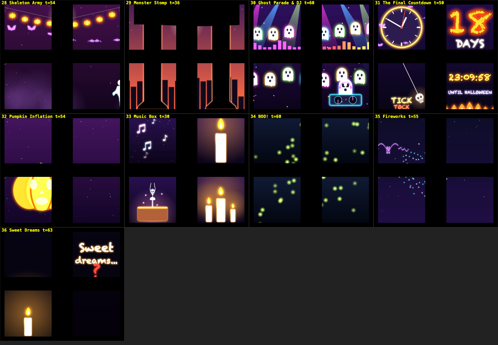
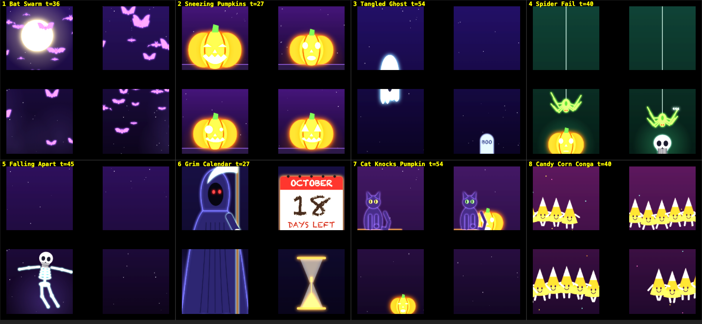
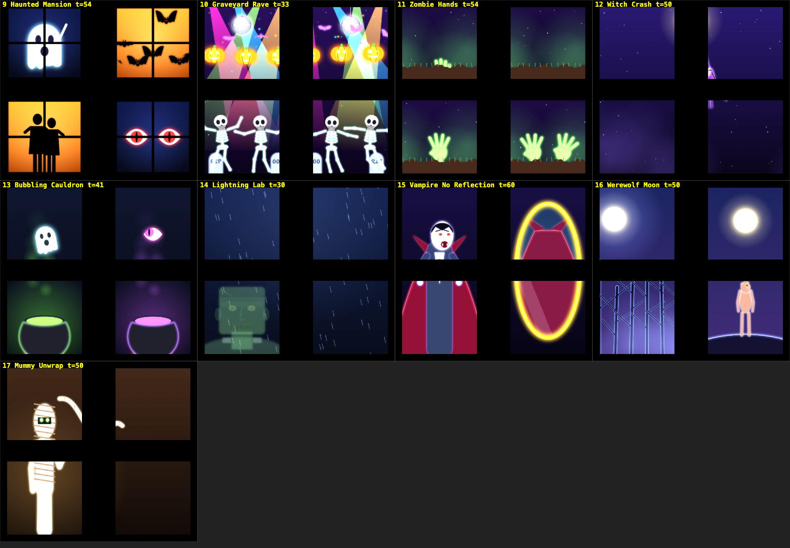
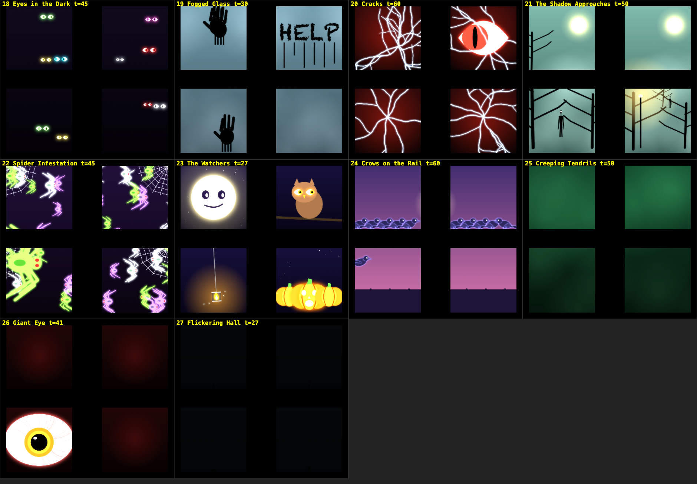
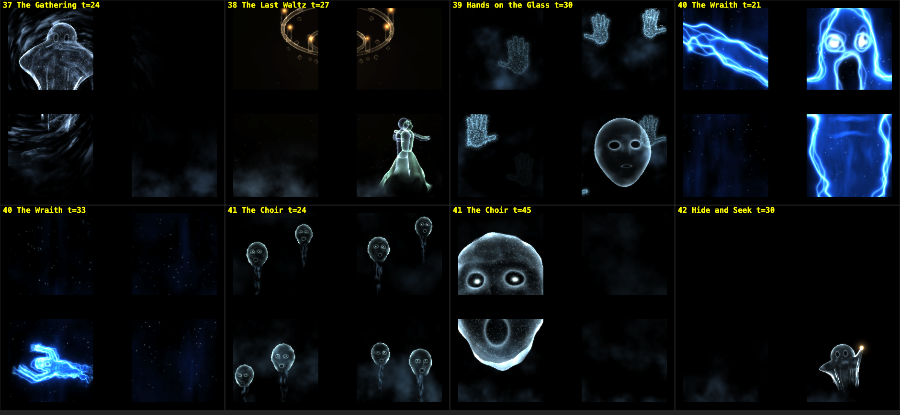

# 🎃 Halloween Window

**A silent, looping Halloween show (about 65 minutes) for a pair of windows. A pocket projector throws it onto white paper on the glass, and the people outside watch.**

42 scenes, from cute to nightmarish: sneezing pumpkins, a ghost caught on the window rail, a skeleton that can't keep its head on, a shadow that walks toward you for 90 seconds, a giant monster that peers in and roars, and a finale of translucent 3D ghosts. Everything is drawn in code. Acts I–IV use plain Canvas 2D; Act V renders 3D apparitions with [three.js](https://threejs.org) (WebGL) and custom shaders. three.js is the one third-party library, and a copy is included in `vendor/`, so nothing is fetched at runtime. There are no video files, no build step, nothing to install and no audio. Open `index.html` and it plays.



**▶ Live version: https://halloween-window.vercel.app** (hosted on Vercel and redeployed automatically on every push to `main`).

> The previews in this README show the four glass panes of each scene, with the rail and wall strip left black. That is how the paper lights up.

---

## Contents

- [The idea](#the-idea)
- [Quick start](#quick-start)
- [The show](#the-show)
- [Controls and calibration](#controls-and-calibration)
- [How it works](#how-it-works)
  - [The 3D act](#the-3d-act-act-v)
- [Project layout](#project-layout)
- [Writing your own scene](#writing-your-own-scene)
- [Adapting it to your windows](#adapting-it-to-your-windows)
- [Safety and good neighbours](#safety-and-good-neighbours)
- [Development tools](#development-tools)
- [Known limits](#known-limits)
- [Roadmap](#roadmap)

---

## The idea

The projector sits inside, aimed out through a double-hung window. Sheets of white paper on the glass act as the screen. Viewers outside see the image reversed, so the whole canvas is mirrored (`M` toggles this).

Two things shaped every scene:

1. **Black is "off".** A projector can only add light. Dark areas stay see-through, so scenes are bright shapes and glows on black. Silhouettes only read in front of a lit backdrop (fog, a moon, a window glow), and the scenes that use them draw that backdrop first.
2. **The window frame is part of the stage.** Two windows, each with an upper and lower sash, make **four panes**. The meeting rail and the wall strip between the windows receive no light, so they work as hiding places. A witch flies into the dark strip and slides down it, a ghost gets stuck on the rail, crows perch on the sill, and a bandage unrolls from one window into the other.

```
        left window          right window
      ┌───────────┐  wall  ┌───────────┐
      │    UL     │ strip  │    UR     │   upper sashes
      ├───────────┤  (5¾″) ├───────────┤   ── meeting rail (dark)
      │    LL     │        │    LR     │   lower sashes
      └───────────┘        └───────────┘
        ~26⅝″ × 54″ each, 20 px per inch → a 1180 × 1080 canvas
```

Scenes come in three layouts:

| Layout | Meaning |
|---|---|
| **4-pane** | One picture across all four panes. |
| **Pair** | Each window's upper and lower sash is one tall scene. The left and right windows can run different stories. |
| **Solo** | Each pane runs its own mini-scene. |

## Quick start

```bash
git clone https://github.com/hectorir/Halloween-Window.git
cd Halloween-Window
open index.html          # macOS. Or open the file in any modern browser.
```

Or just open the live version above. Calibration and the mirror setting are stored per web address, so the online copy and a local `file://` copy keep separate settings. Pick one for the nightly show and always open it from that same address.

Then:

1. Click the page once so the keyboard works, and press **`F`** for fullscreen.
2. Aim the projector at the paper and press **`C`** to calibrate (see below), then **`C`** again to save.
3. For unattended nightly use, launch Chrome in kiosk mode:
   ```bash
   open -a "Google Chrome" --args --kiosk "file://$PWD/index.html"
   ```

It needs a current Chromium-based browser (it uses `roundRect`, canvas shadows and, for Act V, WebGL). Chrome is the tested target. The page keeps the screen awake with the Screen Wake Lock API where available.

## The show

The loop is about 65½ minutes (3928 s, the sum of the scene lengths). It escalates through four acts of 2D scenes, and Act IV ends with a candle blown out into darkness. Act V, "the night isn't over", rises out of that darkness with six 3D ghost stories, and its last ghost fades back into the dark, so the restart with the bat swarm is gentle. Scenes in Acts I–IV are 80–140 seconds long and repeat a short gag (12–25 s) several times, so anyone walking past catches a full joke. Act V scenes are 48–62 s mini-stories (the ghost appears, builds to a peak, then disappears).

| Act | Mood | Highlights |
|---|---|---|
| **I. Trick or Treat** (≈12 min) | Cute and funny | Bat swarm, sneezing pumpkin chain, tangled ghost, failed spider, falling-apart skeleton, Grim Reaper calendar, cat vs pumpkin, candy corn conga |
| **II. Haunted Night** (≈15 min) | Spooky fun | Haunted mansion windows, graveyard rave, zombie hands, witch crash, cauldrons, lightning lab, vampire with no reflection, werewolf, mummy |
| **III. Something's Watching** (≈16 min) | Creepy | Eyes in the dark, fogged glass, cracks, the approaching shadow, spiders, watchers, crows, tendrils, giant eye, flickering hall |
| **IV. Finale** (≈17 min) | Big set pieces, then a soft landing | Skeleton army, monster stomp, ghost parade and DJ, countdown, pumpkin inflation, music box, BOO!, fireworks, sweet dreams |
| **V. The Night Isn't Over** (≈5½ min) | Eerie, "realistic" 3D ghosts (WebGL) | A sheet ghost condensing out of a smoke vortex, a ghostly waltz under a chandelier, hands pressing on the glass, a screaming electric-blue wraith, a choir of faces that merges into one huge face, a child ghost playing hide and seek |

**Full scene-by-scene guide: [EPISODES.md](EPISODES.md).**






### The live countdown

Scene 6 (Grim Calendar) and scene 31 (The Final Countdown) read the laptop clock. They show days and `hh:mm:ss` until Halloween, "TONIGHT" on Oct 31, and "SEE YOU NEXT YEAR" in November. Add `?date=2026-10-20` to the URL to preview any date.

## Controls and calibration

Full reference: **[CONTROLS.md](CONTROLS.md)**.

| Key | Action |
|---|---|
| `F` | Fullscreen |
| `M` | Mirror on/off (on by default, saved) |
| `P` | Pause |
| `N` / `B` | Next / previous scene (also `→`/`←`, and `Page Down`/`Page Up` for a Logitech R400 clicker) |
| `F5` | Pause (clicker start button) |
| `1`–`5` | Jump to an act |
| `D` / `H` | Debug overlay with fps / help overlay |
| `C` | Calibration mode |

**Calibration** (`C`) draws an outline and a label on each pane. Pick a pane with `1`–`4`, move it with the arrows, and resize it with Shift + arrows. `R` resets the selected pane. Press `C` again to leave. Offsets are stored in the browser's localStorage and reloaded on every start. They are lost if you clear site data, use a private window, or open the page from another browser, profile or path.

There is no keystone correction. Use the projector's own keystone for that.

URL options: `?s=12&t=30` (start at a scene and time), `pause=1`, `mirror=0`, `date=YYYY-MM-DD`, `dbg=1`, `cal=1`, `still=1`, `gl=0.5` (fixed internal resolution for the 3D act, see below).

## How it works

Each frame:

1. A scene function draws onto an off-screen **1180 × 1080 canvas**, using plain Canvas 2D. Act V scenes render a three.js scene into a shared off-screen WebGL canvas and copy it onto the same canvas with `drawImage` (see [The 3D act](#the-3d-act-act-v)).
2. A **cheap bloom** adds glow. The canvas is downsampled to 1/4 and 1/8 size and added back with additive blending. This replaces expensive full-screen blur and works in any browser.
3. Each **pane** is copied from the scene canvas to the output canvas using its calibration offsets. Everything outside the glass stays black.
4. The page flips the output canvas horizontally with CSS when mirror mode is on. Calibration labels counter-flip so they stay readable.

Other details:

- **Scene registry.** Every scene is registered with `S(act, name, seconds, kind, drawFn)`. Durations are used exactly as written, the loop length is their sum, and the scene is found from the loop clock.
- **Deterministic randomness.** `rr(n)` is a hash-based random in [0, 1). Scenes avoid `Math.random()`, so a given frame always looks the same. This makes the contact-sheet tests below possible.
- **Fades.** Every scene fades through black at both ends (1.5 s), so the show never flashes between scenes.
- **No assets.** Characters are code: a skeleton rig, ghosts, bats, spiders, zombie hands, crows, a cat, a witch, an eye, a moon with a face, and so on. Act V's ghosts, hands and faces are procedural meshes and shaders. The only resource loaded from the internet is the Creepster font from Google Fonts. Offline, it falls back to Chalkduster or Impact.

### The 3D act (Act V)

- **One renderer.** `ghost3d.js` creates a single `THREE.WebGLRenderer` the first time an Act V scene is drawn. Each scene builds its three.js scene once, when it is first shown, and caches it. Every frame the scene sets uniforms and transforms for time `t`, renders, and is copied straight onto the 2D canvas, so bloom, pane masking and fades work as in the other acts.
- **Still a pure function of `t`.** Nothing carries over between frames. Particle positions are computed in the vertex shader from `t` and per-particle seeds. Trailing cloth is done by sampling the ghost's path at earlier times (`t − 0.1 s`, `t − 0.2 s`, …) and bending the hem toward those positions. Scenes can therefore be scrubbed, jumped to with `N`/`B` and rendered out of order.
- **Techniques.** The ghosts are translucent shells drawn with additive blending: fresnel rim light, drifting fbm noise inside, hollow eyes and mouth, noise-threshold dissolves with a glowing edge, and folds baked into the sheet so the rim light catches them. Faces are sculpted spheres with a jaw that drops in the shader. The wraith is a signed-distance figure drawn on several stacked camera-facing quads, with an echo trail during its lunges. Smoke vortices, fog and light cones are full-screen domain-warped noise. All of it is lit only by its own glow, on black.
- **Resolution.** WebGL renders at 0.6 × the canvas (708 × 648), which is about the native resolution of a 720p projector, and is upscaled with `drawImage`. If the live page stays below about 22 fps for 3 seconds, it lowers this step by step to 0.35. If that is still too slow, or WebGL is unavailable, Act V draws a faint 2D ghost instead. `?gl=0.4` fixes the resolution and turns this adaptation off.

## Project layout

```
index.html        page shell, canvas and HUD
core.js           canvas sizes, pane geometry (CFG), scene registry, countdown, render pipeline, bloom
sprites.js        shared drawing helpers and characters (pumpkin, ghost, bat, skeleton rig, eye, moon, ...)
act1.js … act4.js the 2D scenes, 8 / 9 / 10 / 9 per act
vendor/           three.min.js (three.js r152.2, MIT licence, classic non-module build, so it loads from file://)
ghost3d.js        Act V engine: shared WebGL renderer, ghost/particle/fog shaders, procedural sheet, face and paths
act5.js           the 6 Act V scenes (42 in total)
boot.js           main loop, keyboard controls, calibration overlay, saved settings
EPISODES.md       what every scene shows
CONTROLS.md       full controls reference
docs/             preview images used by this README
dev/              contact-sheet, fuzz and perf pages (not needed to run the show)
```

## Writing your own scene

Add a call to one of the `act*.js` files. The function receives a 2D context and the time in seconds since the scene started.

```js
// kind 'A': you draw the whole 1180×1080 canvas
S(1, 'My Scene', 90, 'A', (g, t) => {
  vg(g, 0, 0, W, H, '#1a0b3d', '#07030f');            // background gradient
  moon(g, 250, 240, 105);                               // sprite
  pumpkin(g, 590 + Math.sin(t) * 40, 700, 2, { m: .5 }); // sprite
});

// kind 'S': called once per pane (i = 0 UL, 1 UR, 2 LL, 3 LR), origin at the pane's top-left
S(1, 'My Panes', 60, 'S', (g, t, c, i, w, h) => {
  ghost(g, w / 2, h / 2 + Math.sin(t * 2 + i) * 20, 2, { t });
});

// kind 'P': called once per window (i = 0 left, 1 right), 532×1080, upper and lower sash joined
S(1, 'My Pair', 60, 'P', (g, t, c, i) => { /* ... */ });
```

A 3D scene uses `G3.scene(name, seconds, build, update)` instead of `S()` (always act 5, 4-pane). `build()` runs once and returns `{scene, cam, ...}`, and `update(o, t)` poses it for time `t`:

```js
G3.scene('My Ghost', 60, () => {
  const o = G3.stage();                                    // THREE.Scene + camera; 1 unit = 1 canvas px at z = 0
  o.g = new THREE.Mesh(G3.sheetGeo(), G3.shell({ uFold: 1, uHem: .8 }));
  o.scene.add(o.g); return o;
}, (o, t) => {
  o.g.position.set(...G3.at(266, 250, 0));                 // screen px (y down) + depth -> world
  o.g.scale.setScalar(80);
  G3.uf(o.g.material, { uDis: 1 - sm(pr(t, 2, 8)) });     // dissolve in over 2-8 s
});
```

Useful helpers (see `sprites.js` and `core.js`):

- **Maths:** `sm` (smoothstep), `pr(t, a, b)` (progress between two times), `eb` (ease-out-back), `lerp`, `cl`, `rr` (hash random).
- **Drawing:** `vg` (vertical gradient), `rg` (radial glow), `ln`, `ell`, `poly`, `xf` (transform scope), `txt`, `fog`, `stars`, `spark`, `burst`, `flame`.
- **Characters:** `pumpkin`, `ghost`, `bat`, `spider`, `skull`, `skel` with `sdance` and `swalk`, `eye`, `moon`, `tomb`, `zhand`, `crow`, `cat`, `witch`.

Tips:

- **Gag cycles.** Loop a short gag with `const cy = t % P`, and vary it per repeat with `k = (t / P) | 0`.
- **Backdrops.** Draw bright shapes on black. For silhouettes, light a backdrop first.
- **Thin lines.** Avoid lines under about 6 px, because a small projector and paper will smear them away.
- **Flicker.** Keep anything flashing at 2 Hz or slower (see below).

## Adapting it to your windows

Pane rectangles live in `CFG` at the top of `core.js`, in canvas pixels (20 px per inch). The default panes are 448 × 430 (upper) and 448 × 438 (lower). Change them to match your glass, or leave them and fit things on site with calibration mode. For different layouts, such as one big window or three panes, edit `CFG.panes` and `CFG.wins`. Scenes of kind `S` and `P` follow those arrays, but the hand-placed coordinates in 4-pane scenes assume the default two-window layout.

## Safety and good neighbours

- **No strobing.** Nothing flashes faster than about twice a second, and there are no full-pane white flashes. Lightning is a fast fade, never a strobe.
- **Jump scares are soft.** The BOO! ghost pops in and shakes, with no flashing and no sound. Act V's wraith lunges at the glass with a fast but smooth move, and its brightness is scaled down as it gets closer, so the close-up glows instead of flashing.
- **Scenes escalate by time.** The cutest scenes come first. Act III and Act V (the 3D ghosts: screaming faces, a lunging wraith) are the creepiest, though nothing is gory. Check that these acts suit the audience that walks past your window.
- **Brightness.** Dark scenes at the end of the loop are meant to ease the street back down, so avoid skipping them.

## Development tools

All in `dev/`, opened from disk in Chrome.

| Page | Purpose |
|---|---|
| `dev/sheet.html` | Contact sheet of scenes. Example: `?from=0&n=12&f=.35`, or `?list=14:3.5,29:41` to pick scene numbers and seconds. |
| `dev/fuzz.html` | Renders every scene at 61 points in time, plus Oct 31 and November, and reports any exception or WebGL shader error (`errors:0` when fine). |
| `dev/perf.html` | Rough CPU-side draw timing. It measures command submission, not GPU time, so use `D` in the real page for fps. |

The previews in `docs/` were produced with `sheet.html` in headless Chrome:

```bash
"/Applications/Google Chrome.app/Contents/MacOS/Google Chrome" --headless=new --hide-scrollbars \
  --window-size=1880,870 --virtual-time-budget=4000 --screenshot=out.png \
  "file://$PWD/dev/sheet.html?from=0&n=8&f=.45,.3,.6,.5"
```

Act V needs WebGL in headless Chrome. Add `--use-angle=swiftshader --enable-unsafe-swiftshader` (software rendering, works anywhere but slowly) or, on a Mac, `--use-angle=metal --ignore-gpu-blocklist` (real GPU). The Act V preview used `?list=37:24,38:27,39:30,40:21,40:33,41:24,41:45,42:30`.

## Known limits

- It has been rendered and fuzz-tested in headless Chrome. Frame rate on a particular laptop and the look on a real projector and paper have not been measured yet.
- Act V needs WebGL. With GPU-backed timing, its scenes took about 5–6 ms per frame (bloom included) on an Apple M4 Pro. A low-end integrated GPU has not been tested. If it can't keep up, Act V lowers its resolution and, if it still can't, falls back to a simple 2D ghost.
- Calibration is per-pane move and resize only (no keystone or rotation).
- The canvas is nearly square, so on a 16:9 projector about 40% of the pixels go unused.
- No audio, by design.

## Roadmap

Tracked in the project's issue tracker. Current ideas:

- Test on the real projector, then adjust brightness, contrast and line weights.
- A brightness / dim control and an automatic nightly schedule (on at dusk, off at bedtime).
- Make calibration survive a browser reset, using an exported or imported JSON file.
- Per-pane keystone and rotation in calibration.
- Optional rendering to a video file, for a player without a browser.
- More scenes and a short "trick or treat hours" text card.

## Credits

Designed and built with [Claude Code](https://claude.com/claude-code) for a real window. Act V uses [three.js](https://threejs.org) (MIT licence, © three.js authors); the copy in `vendor/` keeps its licence header.
